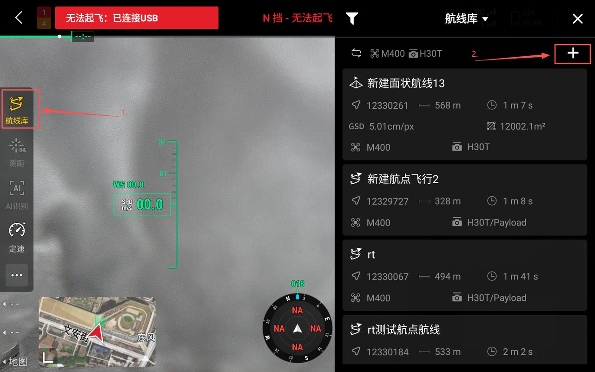
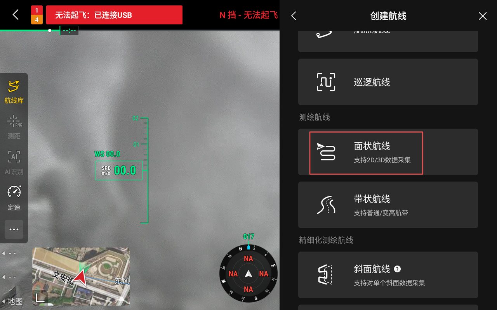
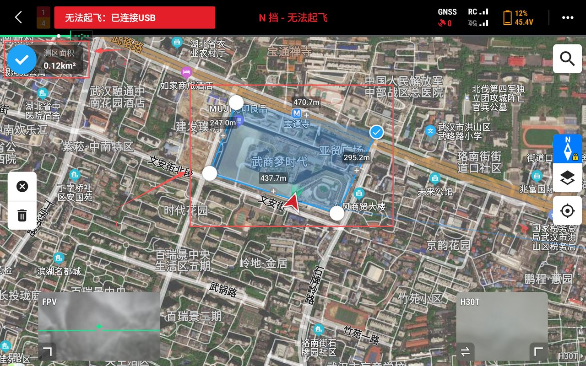
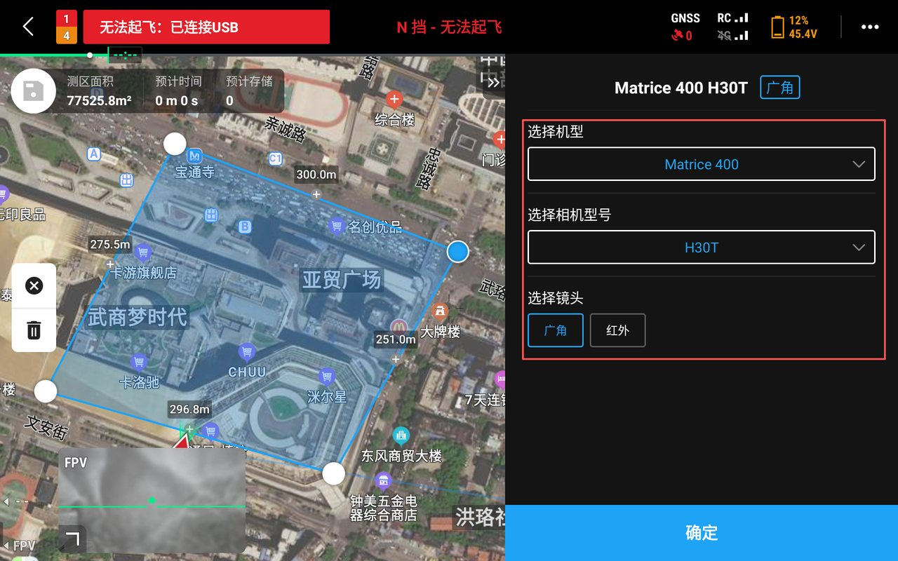
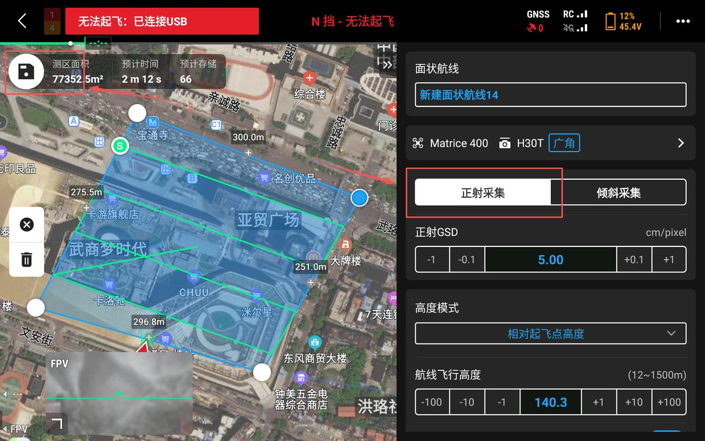

## 创建航线

MipMap RT 使用正射航线采集影像。下面以面状航线为例，在 DJI Pilot 2 中新建一条正射采集航线。

:::tip
选择航线任务时，采集模式必须设为「正射采集」，并关闭高程优化。
:::

1. 点击左侧`航线库`，在右侧航线列表中点击`+`。

2. 在创建航线中选择`面状航线`。

3. 在地图上框选测区，点击左上角蓝色对号。

4. 选择机型、相机型号和镜头，点击`确定`。

5. 采集方式选择`正射采集`，完成高度等其余设置后，点击左上角`保存`。

