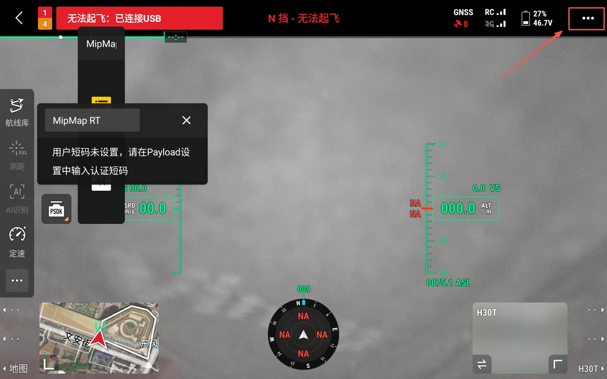
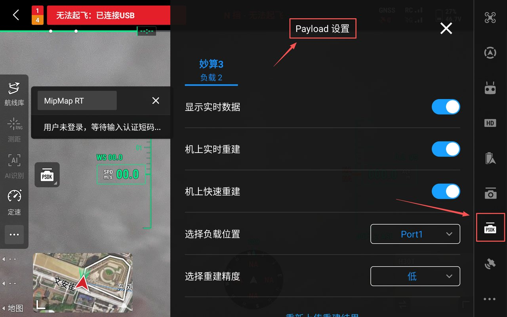
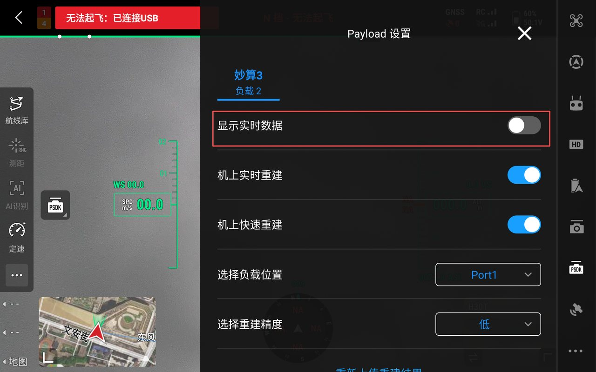
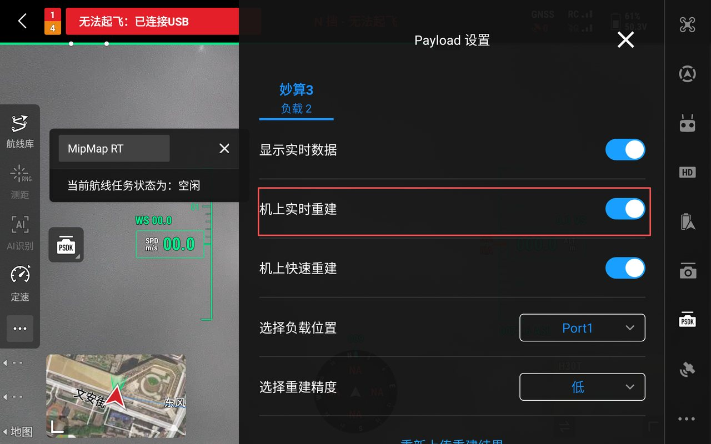
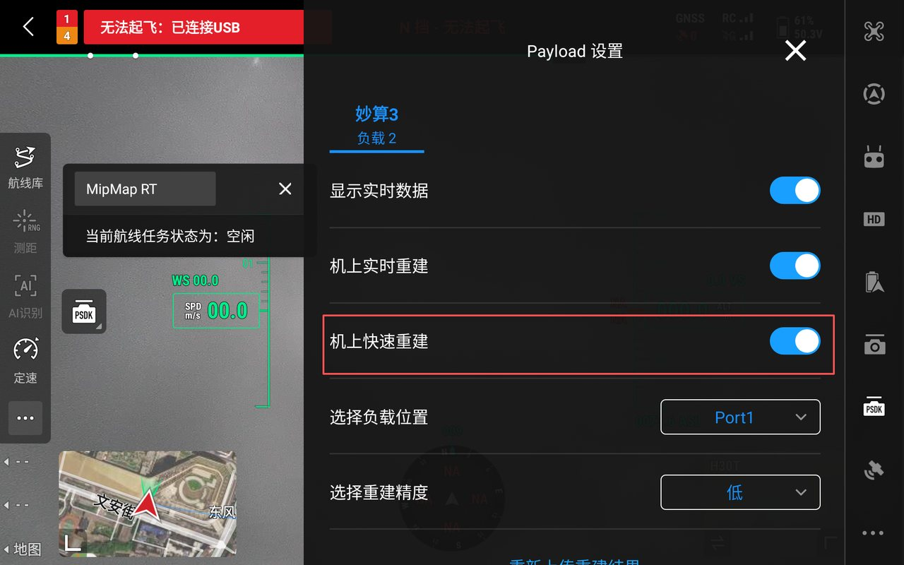
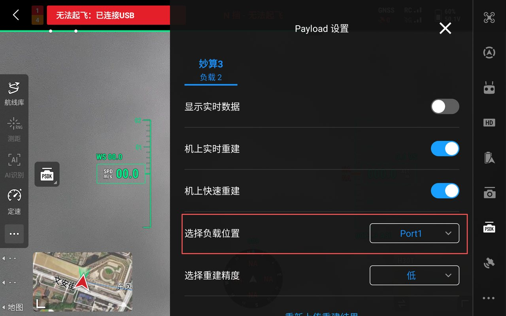
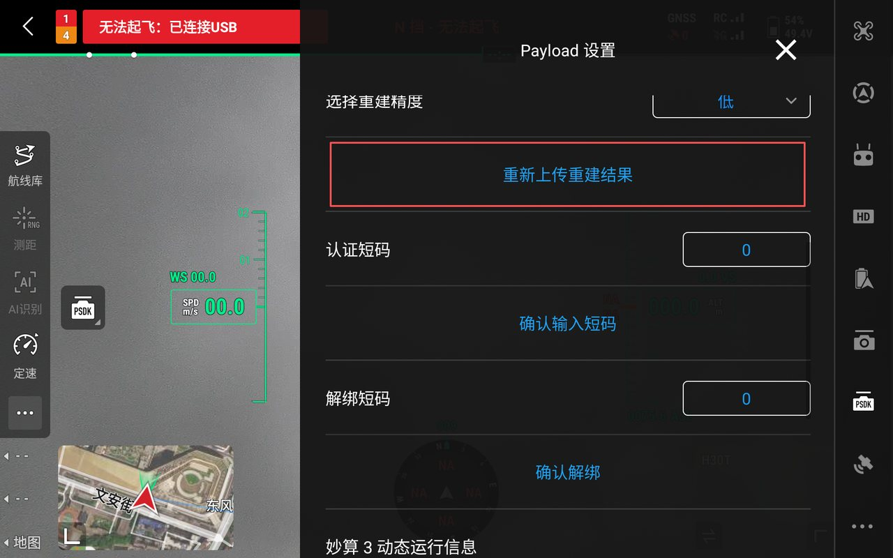
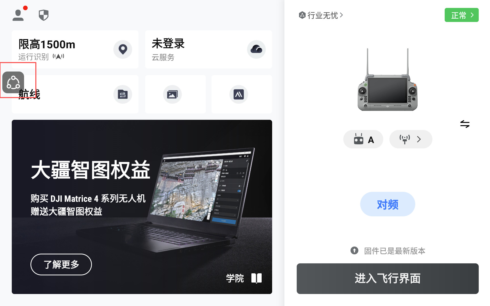
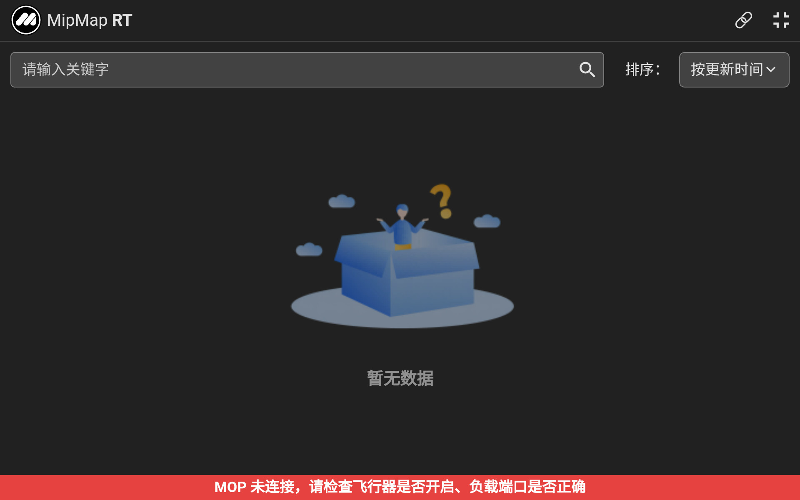

## 功能介绍

### MipMap RT
MipMap RT 是一款运行在大疆妙算3上的实时二维快拼和三维重建应用。安装后可以拉取飞行器的影像数据，实时生成二维正射影像数据和三维模型。支持有网和无网环境下的实时成果预览，实现“飞行--建图--预览”的生产模式。

所有功能都在 Payload 设置中。飞行界面点击右上角`…`打开设置，再点击右侧`PSDK`，即可进入。

#### 显示实时数据

开启后，消息浮窗显示在画面中。关闭后，浮窗消失。本次的开关状态会作为下次启动时的默认状态。建议全程开启。

#### 机上实时重建

默认开启。开启后，执行航线时在机上进行实时二维重建。关闭后，执行航线时跳过实时重建。

#### 机上快速重建

默认开启。开启后，航线任务结束后在机上进行快速三维重建。关闭后，航线结束后跳过快速重建。

#### 选择负载位置

可选 Port1、Port2、Port3，Port4分别对应 M400 上的 E-Port V1、E-Port V2、E-Port V3、E-Port V4。按相机负载的实际挂载位置选择。默认是 Port1。

#### 重新上传重建结果

重建成果上传失败时，点击`重新上传重建结果`。

:::tip
必须飞行器搭载了4G模块，本身有网络时，才可以进行成果上传。
:::

#### 短码认证与解绑

`认证短码`和`确认输入短码`用于首次验证并绑定当前妙算 3。`解绑短码`和`确认解绑`用于解除绑定，以便把同一条短码换到另一台妙算 3。操作步骤见 [短码申请与激活](../overview/3code)。

### MipMap RT Viewer

在运行 MipMap RT 的同时，运行[MipMap RT Viewer](../overview/2software)，可在没有网络的环境下进行成果接收和预览。

#### 启动
在 DJI Pilot 2 中点击浮窗按钮和`返回插件 APP`，即可运行和跳转到 MipMap RT Viewer。

此时若运行 MipMap RT 则会将重建成果从机上发送到遥控端，MipMap RT Viewer会实时接收并渲染。

:::tip
若选择M400飞行器，则需按照妙算3实际挂载端口进行选择。
:::