## 完整流程

:::tip
初次使用时请先查看[上一章节](../overview/1hardware.md)
:::
 
### 创建任务

短码激活后，运行 MipMap RT 和 MipMap RT Viewer，当浮窗提示`初始化完成`和`MOP Connect Success`时，
表示程序正常启动，MipMap RT Viewer 成功接收到当前任务。（如果不进行遥控器端的成果浏览，则不必打开 MipMap RT Viewer）

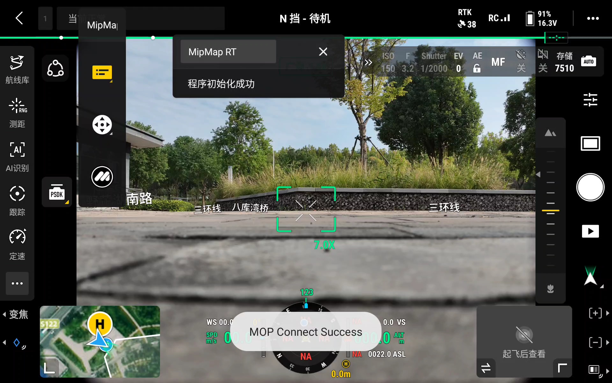

此时切到 MipMap RT Viewer 中可以看到当前新建的任务界面

点击任务列表即可进入成果界面

切回 DJI Pilot2 当提示任务状态为：`空闲`时，可在`航线库`中选择[创建](1route.md)好的航线并执行。

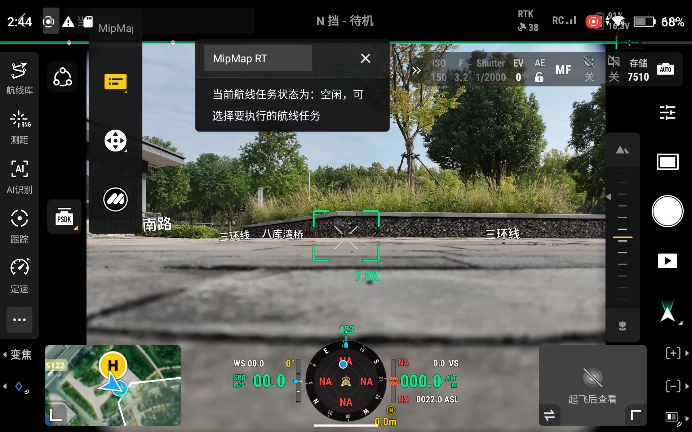

### 执行任务

飞行器升空后，按照预设航线飞行，当抵达第一个航点时开启采集正射影像，MipMap RT 会实时拉取影像并进行处理。

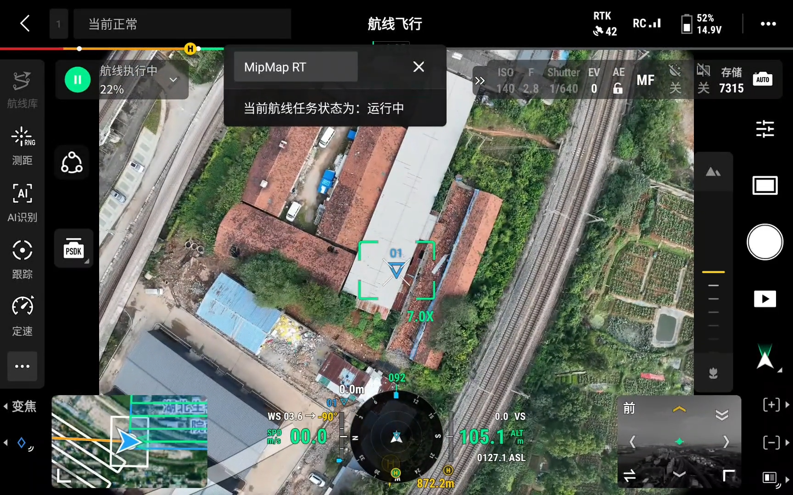

若此时开启了[机上实时重建](2feature.md#机上实时重建)选项,会实时生成二维正射瓦片成果，发送到地面的遥控器上，MipMap RT Viewer 可进行实时渲染和预览。

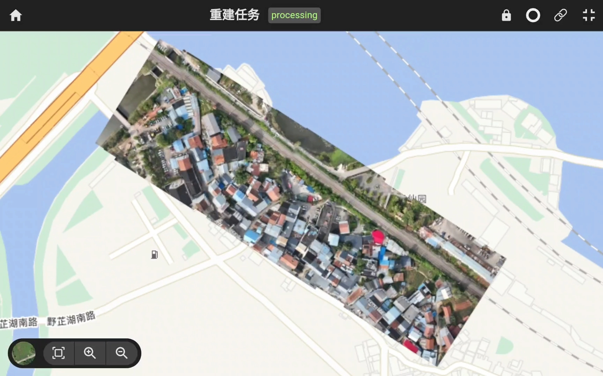

点击右侧的`浮窗`按钮，可从全屏切换到窗口模式，方便一边观察飞行情况一边预览重建成果。长按浮窗可进行拖动，调整窗口位置和大小。

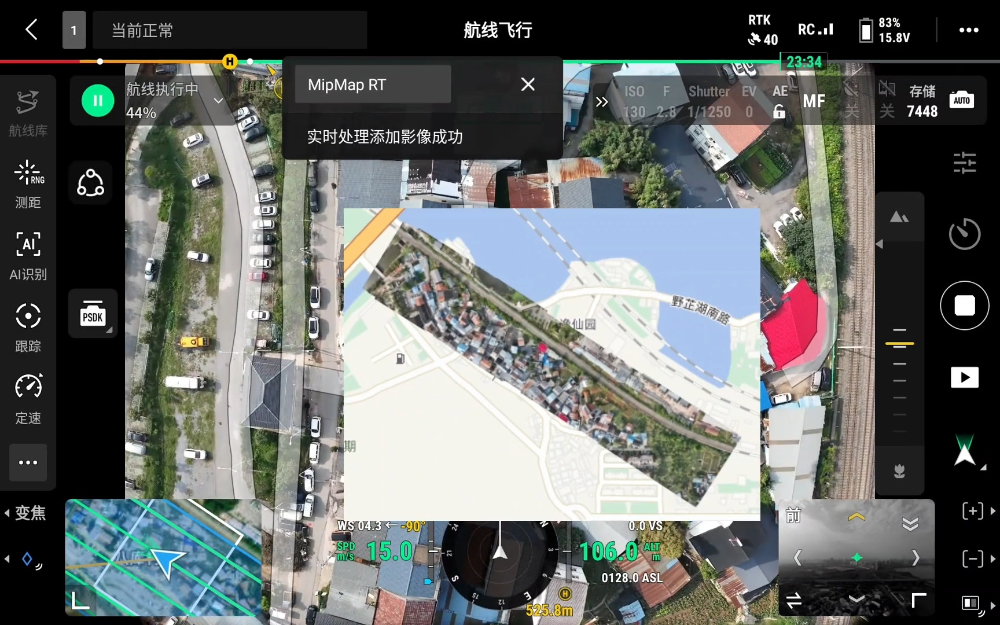
 
当飞抵最后一个航点，飞行器开始返航，若此时开启了[机上快速重建](2feature.md#机上快速重建)选项，程序会进入后处理，进行二维成果优化和快速三维重建。

浮窗会实时显示处理进度，当处理完成后将成果发送给 MipMap RT Viewer 进行渲染。

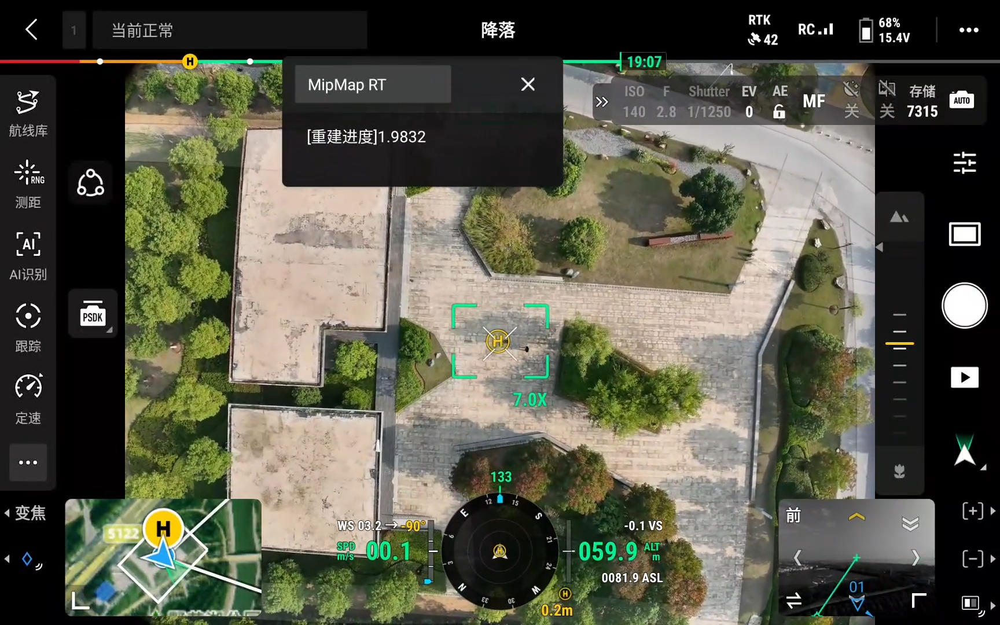

:::tip
此时若中途退出，则任务中断。
:::

当弹窗提示`任务完成`时，表明所有处理都已结束，此时切到 MipMap RT Viewer 即可看到最终成果。

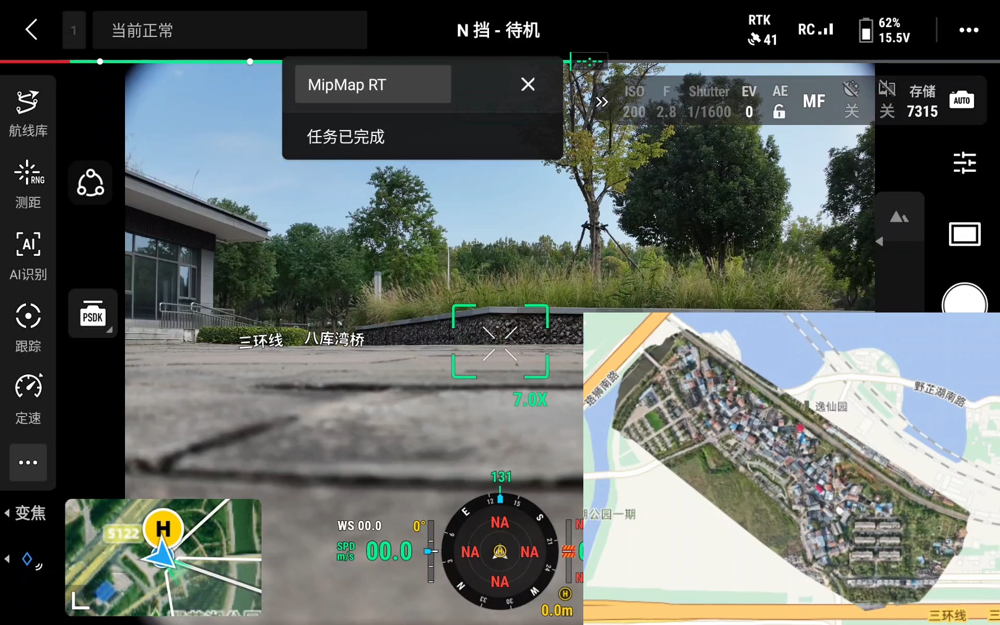

可以在MipMap RT Viewer查看完整二维和三维成果，并进行缩放和旋转等操作

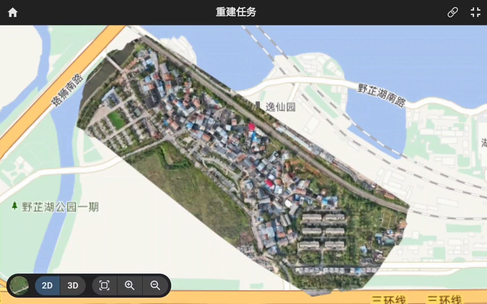

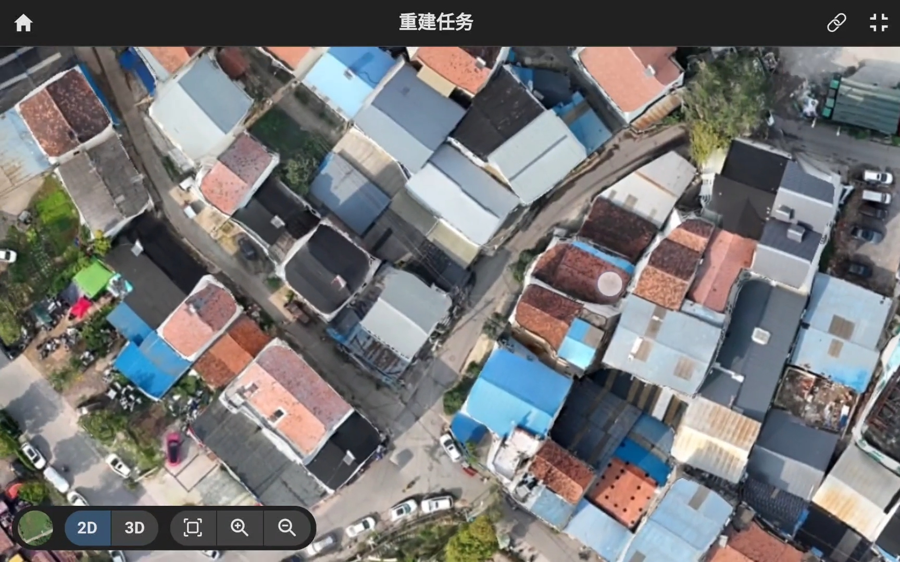

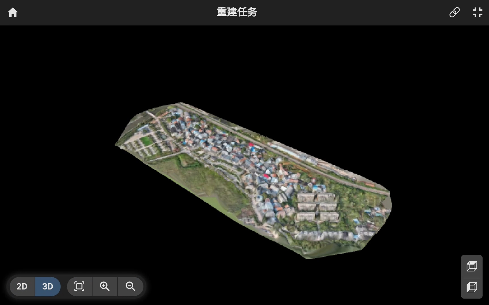

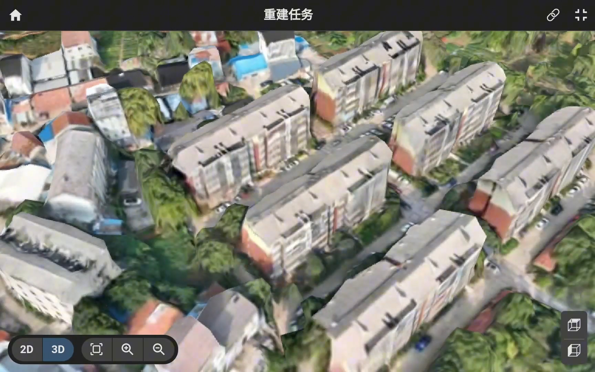

当飞行器搭载有 4G 网卡，妙算 3 便可以实时联网，此时不仅可以使用 MipMap RT Viewer 接收重建成果，还可以将成果上传至远端,

在任意联网设备中登录[查看网站](https://www.mipmap3d.com/realtime/#/)，便可预览重建成果。

### 数据导出

当飞行器降落后，可进行成果导出，导出时需外接拓展坞和SD卡，在遥控器上执行`文件导出`即可导出全部成果。

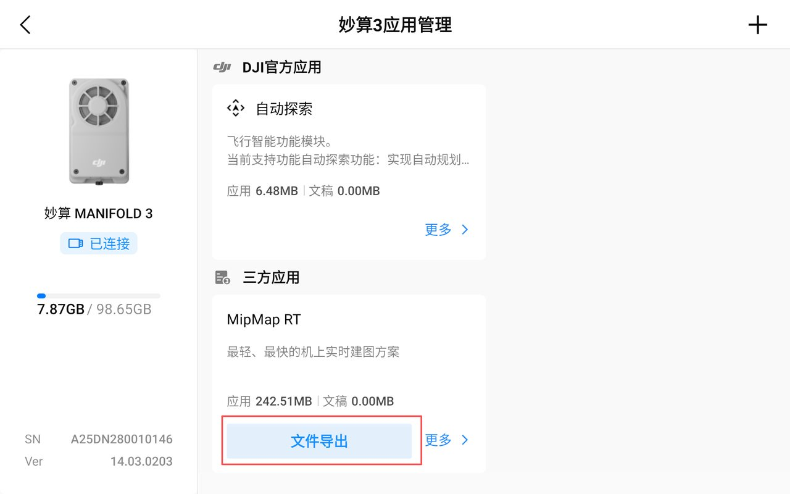

每个任务完成后可导出`.mprj`文件，将该文件导入 [MipMap Desktop](https://www.mipmap3d.com/products/mipmap-desktop) 软件中，可实现 RT 成果 和 Desktop 的无缝兼容。

借助 Desktop 的强大功能，RT成果可实现 浏览、裁剪、局域网分享等多种操作。

