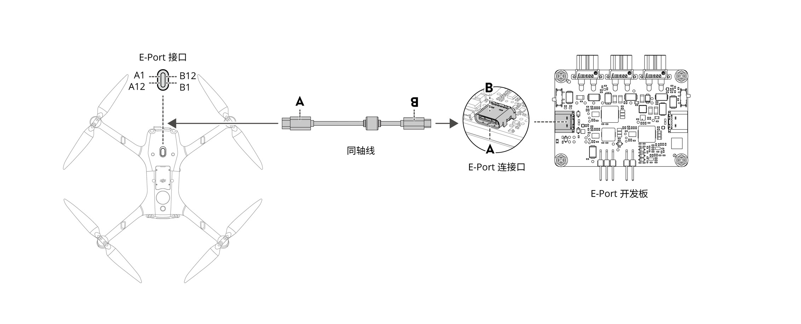
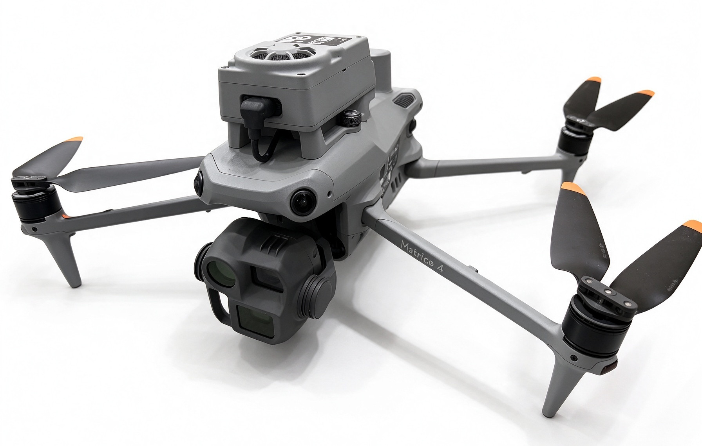
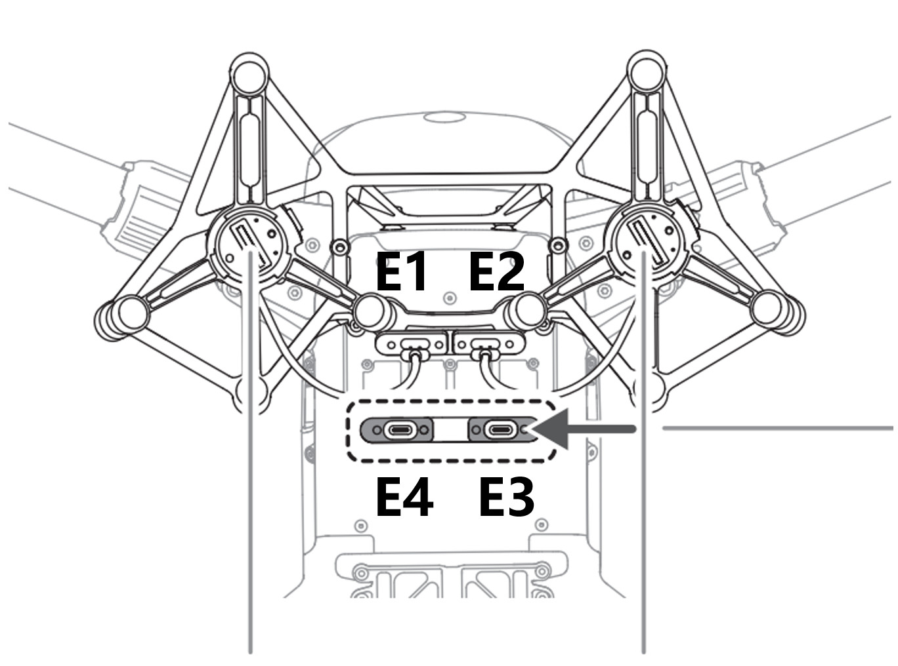
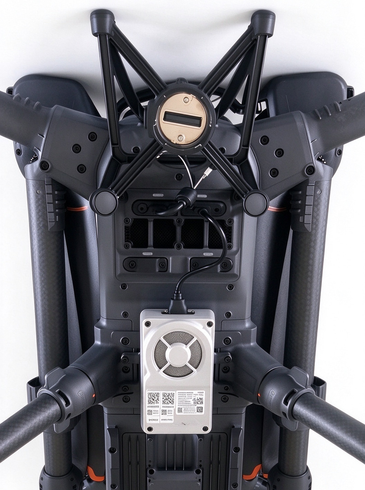
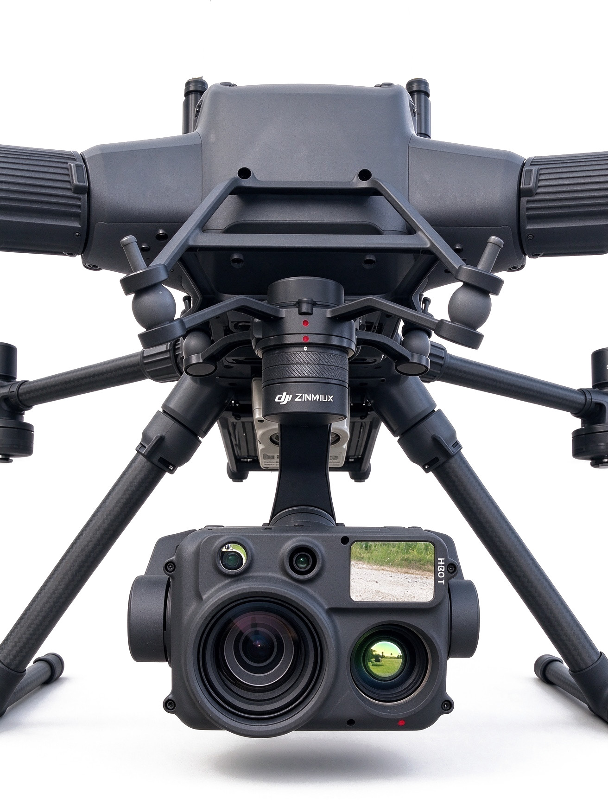

## 硬件连接

MipMap RT 运行在妙算 3 上。目前大疆官方支持的可搭载妙算3的飞行器有M4系列、M4D系列、M400等。其中M4系列、M4D系列自带相机，而选择M400需要额外的相机负载，目前妙算所兼容的有H30系列，因此在使用MipMap RT前需确保您的硬件符合需求

### 可支持的硬件组合

| 飞行器类型 | 相机负载 | 是否支持 |
| --- | :---: | :---: |
| M4系列 | \\ | √ |
| M4D系列 | \\ |√|
| M400 | H30、H30T 等 |√|
| M400 | P系列、L系列 |×|

:::tip
请按照支持的硬件组合选择您的硬件
:::

### M4/M4D系列连接方式
只需使用E-Port V2 同轴线将妙算3与M4/M4D系列连接即可

接线图

实物图

### M400系列连接方式
#### 连接妙算3
Matrice 400 底部存在 4 个 E-Port V2 接口，如下图所示（可对照实物辨认）：

这些接口都可以使用E-Port V2 同轴线连接妙算3

实物图

#### 连接相机负载

安装并连接相机负载。下图为已装到云台上的 H30T。

实物图

:::tip
M400在安装妙算3时需记住连接口序号，供后续使用
:::

