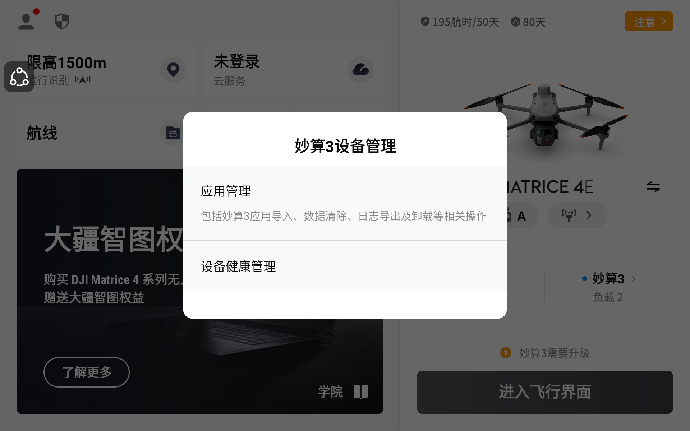
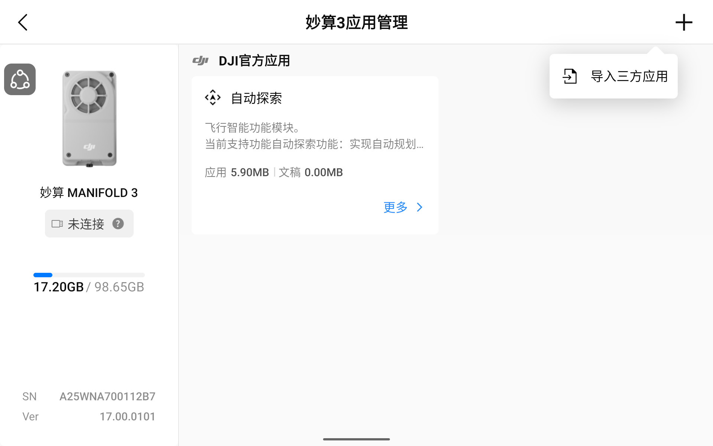
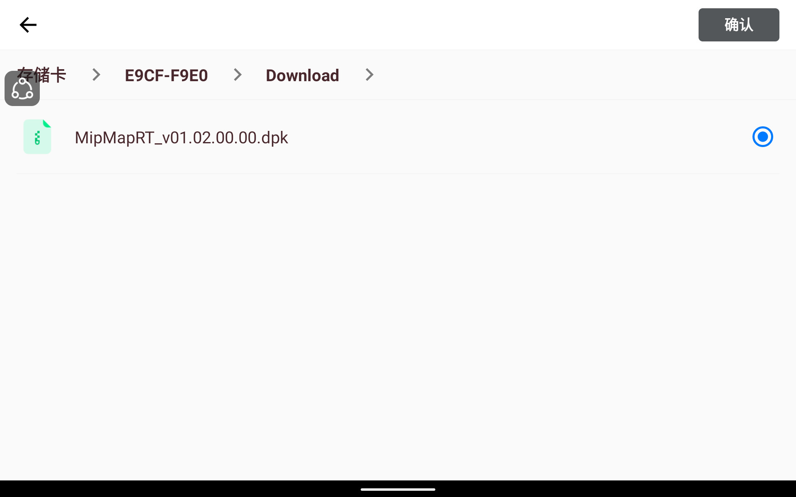
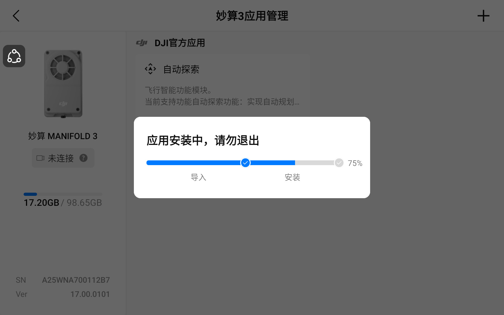
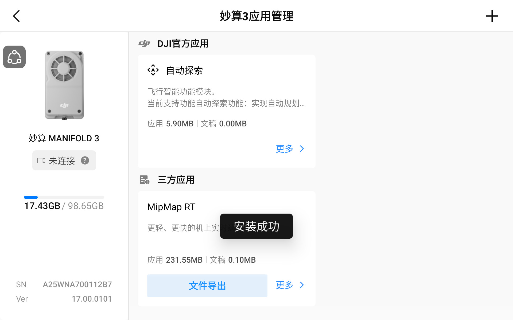
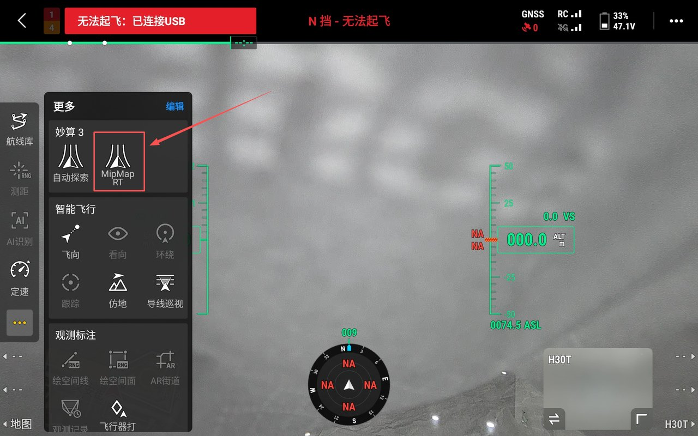
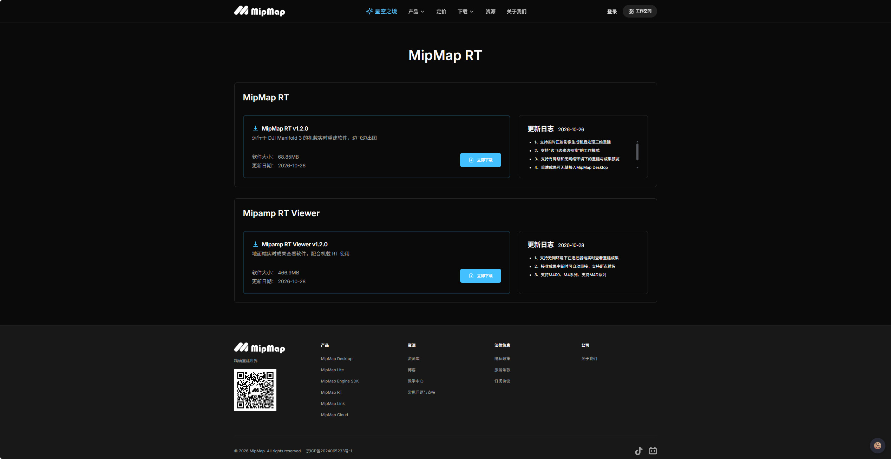
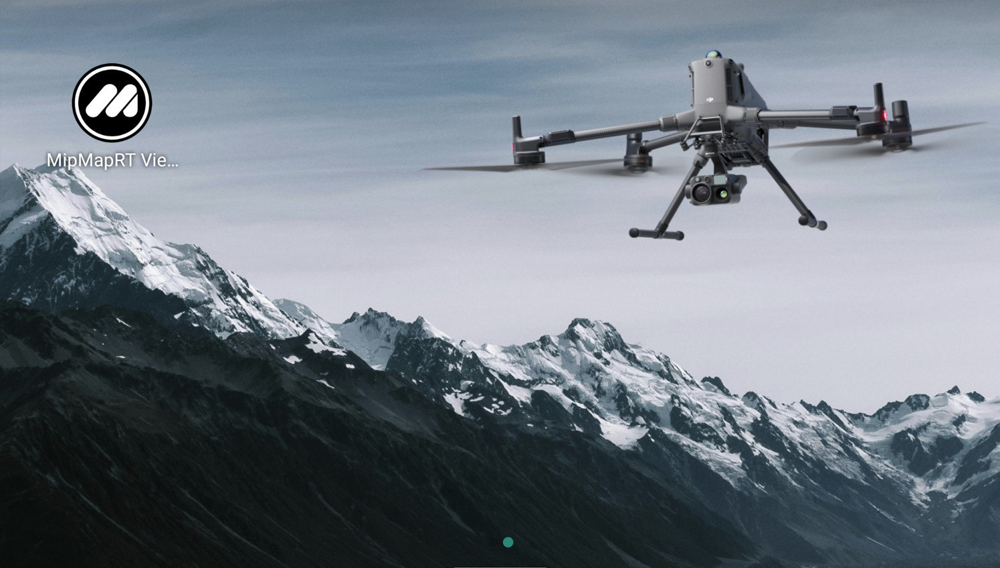
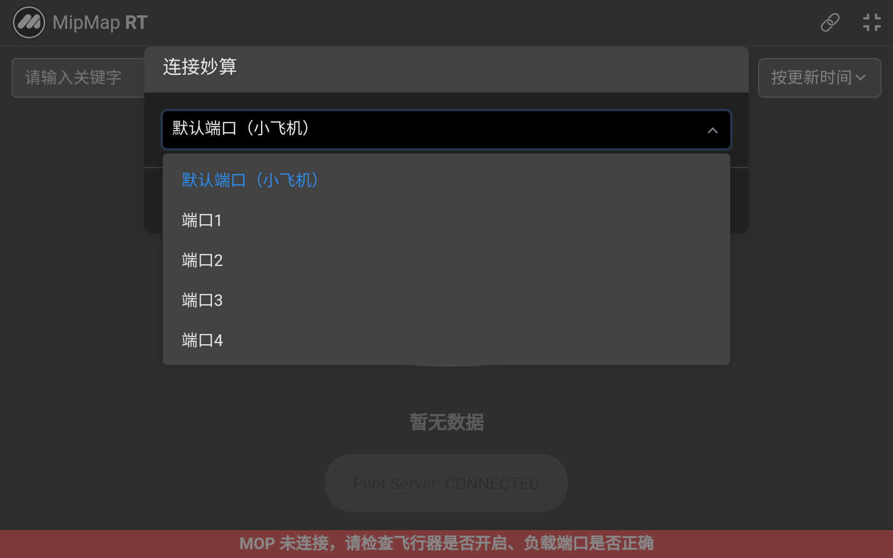

## 软件安装
:::tip
安装前请将飞行器、遥控器、妙算 3 和相机负载等固件更新到最新，并保证一致性。
:::

### 安装MipMap RT
[MipMap RT](https://www.mipmap3d.com/download/rt)是重建的主体应用，安装和运行在妙算3中，需使用SD卡和带屏遥控器进行安装。

#### 拷贝安装包
MipMap RT的后缀名为 `.dpk`，需先将[安装包](https://www.mipmap3d.com/download/rt)拷贝到遥控器 SD 卡中。

#### 打开应用管理

在 DJI Pilot 2 主界面点击`妙算3`，打开`妙算3设备管理`，再进入`应用管理`。

#### 导入并安装

点击右上角`+`，进入`导入三方应用`。

选中安装包，点击`确认`。

导入和安装过程中不要退出当前页面。

出现`安装成功`，且三方应用列表中显示 MipMap RT，即表示安装完成。

#### 确认入口
进入飞行界面后，在左侧`更多`里的`妙算3`一组中可以找到 MipMap RT。

### 安装MipMap RT Viewer
[MipMap RT Viewer](https://www.mipmap3d.com/download/rt)是MipMap RT配套的成果查看应用，安装和运行在遥控器中,可在没有网络环境时进行重建成果的实时预览。

#### 下载&安装
使用遥控器访问[链接](https://www.mipmap3d.com/download/rt)进行下载

安装完成

#### 首界面

首界面

:::tip
如果机型为M4/M4D系列，则选择默认端口，如果为M400，根据妙算3实际挂载端口进行选择。
:::