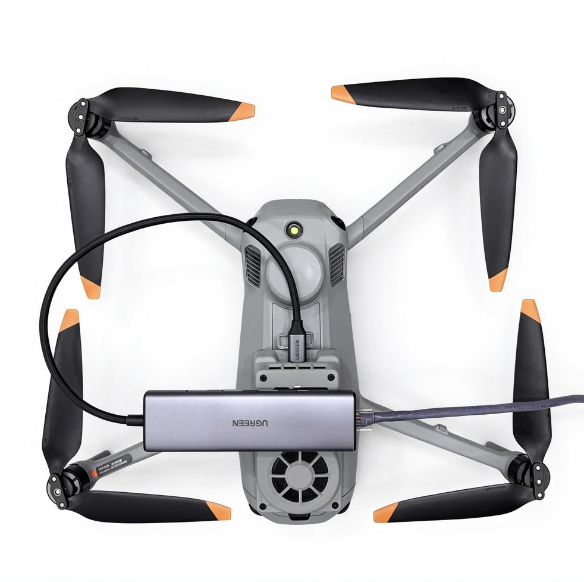
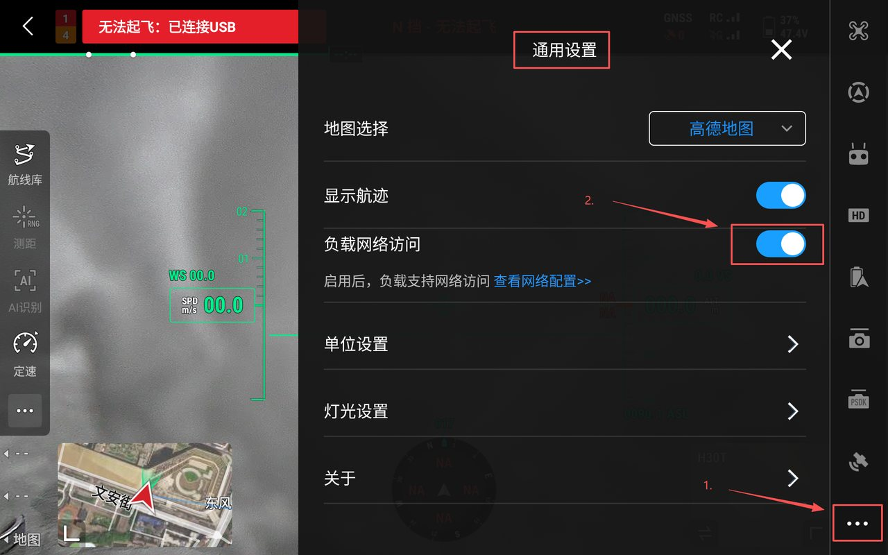
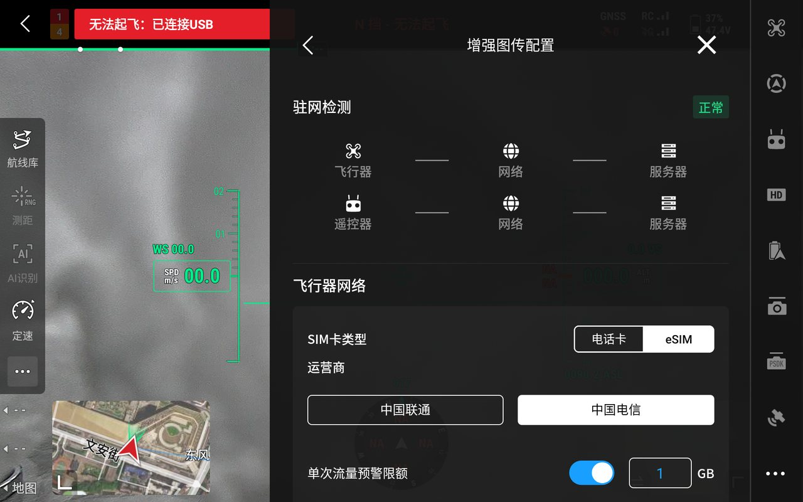
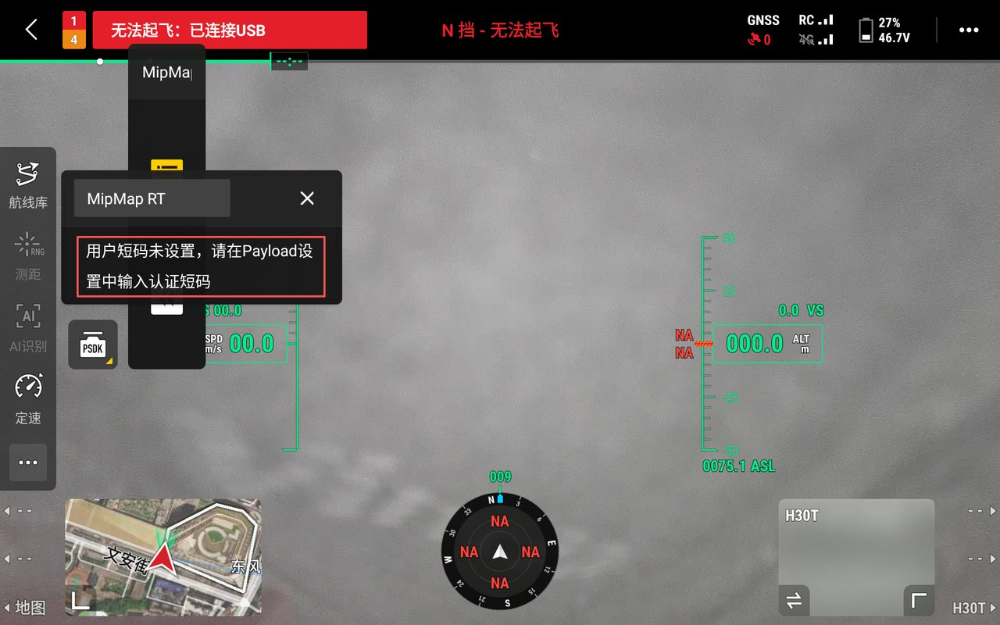
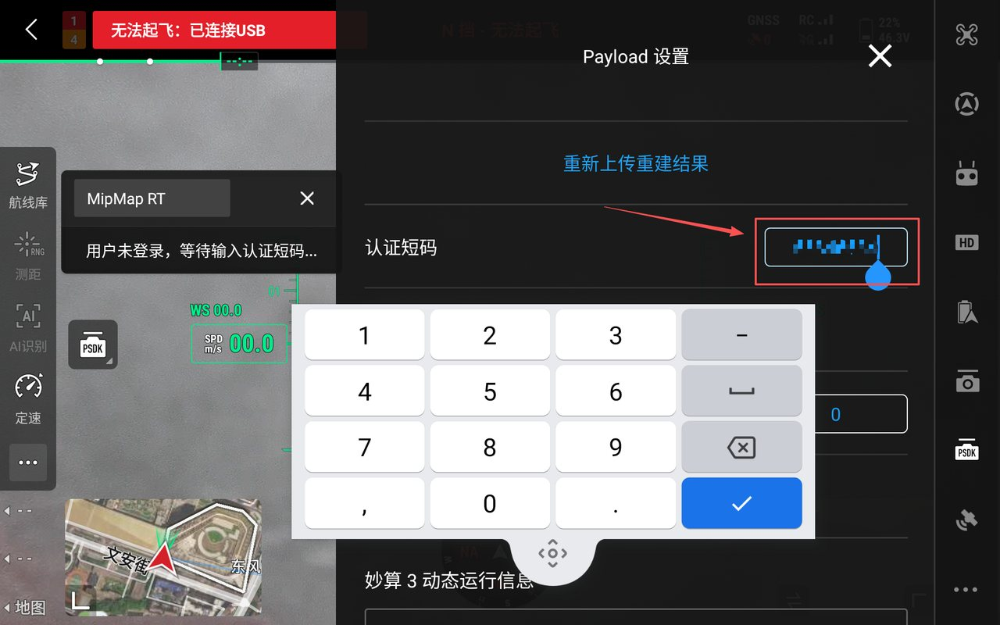
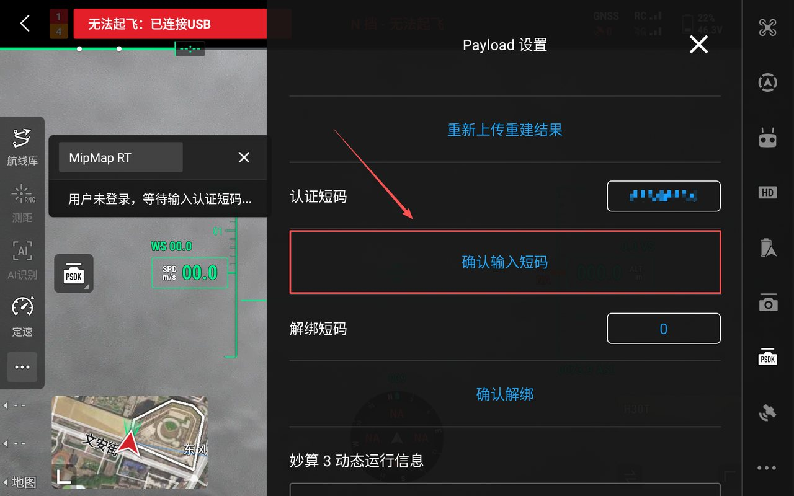
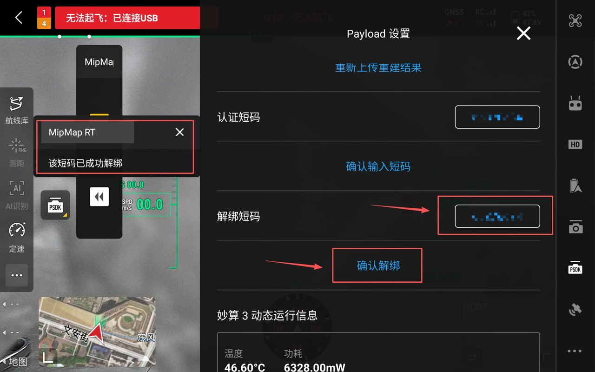

## 短码申请与激活
:::tip
运行MipMap RT需要获得授权短码，请联系[MipMap](https://www.mipmap3d.com/about#contact-us)工作人员进行获取。
:::
### 短码申请
提供在MipMap官网[注册](https://www.mipmap3d.com/register)过的手机号，即可免费获取试用短码
### 短码激活
:::tip
激活短码需要联网，短码与妙算设备绑定，可更换绑定设备，但同一时间只能绑定一台。
:::

#### 妙算联网

##### 未安装4G模块
 
飞行器本身不能联网时，需要给妙算3单独联网。以M4E为例：
妙算3挂好后，需要一根带有网口的拓展坞，一端接路由器，一端接妙算3，为妙算单独供网。

##### 安装有4G模块

飞行器本身可以联网时，妙算 3 挂载后即可使用飞行器的网络。以 M400 为例，在DJI Pilot2中简单设置即可使妙算3联网：

1. 进入`通用设置`，打开`负载网络访问`

2. 在增强图传配置中选择 SIM 卡类型和运营商

#### 输入短码

:::tip
输入短码前请确认妙算 3 已经联网。
:::

首次运行时，浮窗会提示 `用户短码未设置，请在 Payload 设置中输入认证短码`。

打开右上角 `设置`，进入`PSDK`中的 Payload 设置。在`认证短码`中输入 8 位授权短码。

点击`确认输入短码`，等待浮窗提示`绑定成功`，即可进行使用。

:::tip
短码激活完成后，后续再次运行MipMap RT时不需要联网激活。
:::

### 短码解绑

需要把短码换到另一台妙算3时，在`解绑短码`中再次输入8位短码，点击`确认解绑`。浮窗显示`该短码已成功解绑`后，该短码可以绑定到其他妙算3设备。

